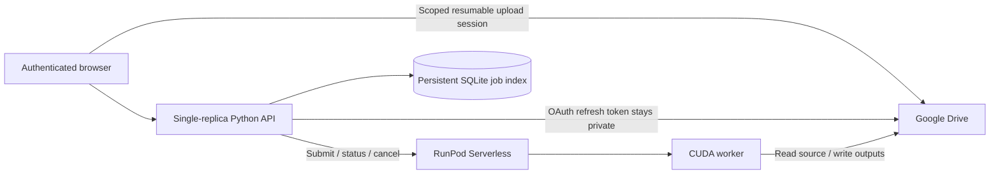

# Architecture and OpenReef reference

## Reference inspected

OpenReefGPU's `cloud/api/src/index.ts`, `cloud/api/src/storage.ts`, `cloud/api/wrangler.jsonc`, and `worker/handler.py` at the available 0.6.5-gpu.5 checkout. The reference uses a Cloudflare Worker control API, server-side Google OAuth refresh credentials, direct resumable Drive uploads, asynchronous RunPod submission/status, and Drive-backed result manifests. It keeps provider secrets out of browser requests. Its OpenReef source version was 0.6.5.

openfishGPU retains those boundaries and uses dedicated Drive roots and a dedicated RunPod endpoint. It deliberately uses a containerized FastAPI control plane with SQLite rather than copying the Cloudflare Worker. SQLite provides a durable compare-and-set submission claim, job history and pagination. Deploy exactly one API replica with one worker process and a persistent volume. A distributed deployment requires a transactional shared database and distributed submission coordination.

The shared workspace has one password and one shared history. It is intended for a trusted research team, not a public multi-tenant service. There are no per-user OAuth accounts or private per-user folders. Deploy behind TLS and an access gateway for larger teams. Cross-origin mutations are rejected; browser sessions use signed, HttpOnly, SameSite=Strict cookies, Secure under HTTPS. The sign-in throttle is in-memory and resets on API restart; it is not a substitute for gateway rate limiting. OAuth uses a server-side refresh token. Only upload-scoped session URLs reach the browser; these are temporary capabilities and must not be logged or shared.

## Data layout

- Dedicated job root: `<job UUID>/job.json`, source video (uploaded jobs), and `output/`.
- Outputs: `tracked.mp4`, `detections.csv`, `tracks.csv`, `species_tracks.csv`, `species_predictions.json`, `gallery.json`, `summary.json`, `settings.json`, `run.json`, track crops and sampled crops, `manifest.json`.
- An existing Drive video stays in its original source folder. The API and worker constrain it to the configured source root.
- RunPod inputs carry Drive IDs, size, validated settings and version identifiers, not OAuth tokens or public video URLs.
- A job is completed only when RunPod returns a durable manifest ID and the API verifies its folder and job identity.
- Raw BoT-SORT track IDs stay consistent across annotated video, tables and crops. Unlike the desktop finalizer, cloud processing does not renumber tracks. Annotated video is silent in this initial release.
- Species inference supports a local Hugging Face classification bundle or Fishial TorchScript bundle. Neither is downloaded at runtime. GPU inference is selected when CUDA is available; missing models result in explicit unidentified tracks.

## Failure and retry semantics

SQLite is authoritative for API state; records are mirrored to Drive for recovery. A submission claim is committed before contacting RunPod. An interrupted/ambiguous submission remains `submitting` or `submission_unknown`; never resubmit automatically because the provider may already be billing. Reconcile privately in the RunPod console, then restore the provider ID with the recovery command. No callback endpoint is exposed. Status and results are refreshed by polling.

Worker progress is coarse by stage, not a time estimate. API history refresh retrieves stored records; opening a job polls RunPod. RunPod status retention is finite. If provider status is unavailable, the API recovers completion from a single durable manifest in the output folder. Multiple manifests from retries require operator reconciliation; the API never starts a replacement job automatically. Worker retries may create duplicate artifact versions in the same folder; only the completed attempt's manifest is exposed. Incomplete uploads, orphan folders and failed attempt outputs require manual cleanup. Cancel requests remain active until RunPod confirms a terminal state.

The SQLite volume must be backed up along with Drive metadata. The recovery utility can rebuild history from `job.json` records and reconcile a provider job ID or a completed Drive manifest. A crash before the first Drive metadata write may leave an empty orphan folder. All API and GPU deployments must use the same version manifest; a version mismatch fails before processing.
